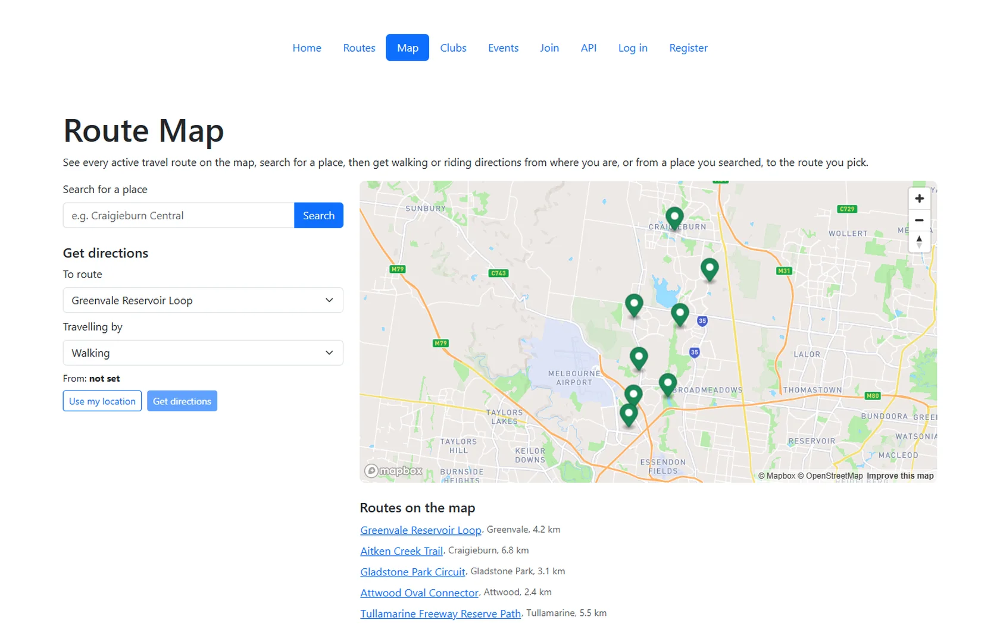
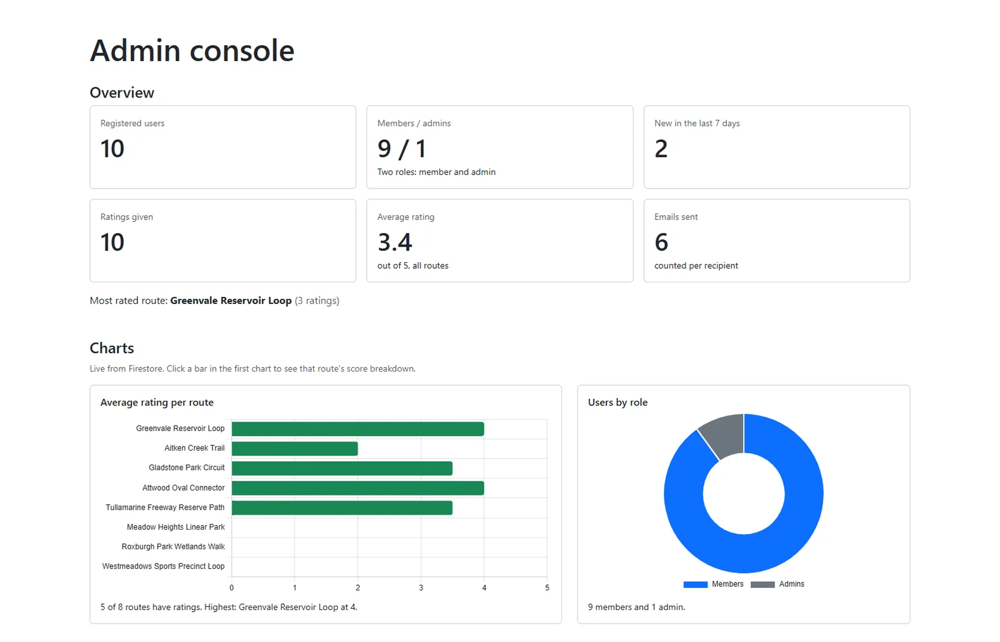
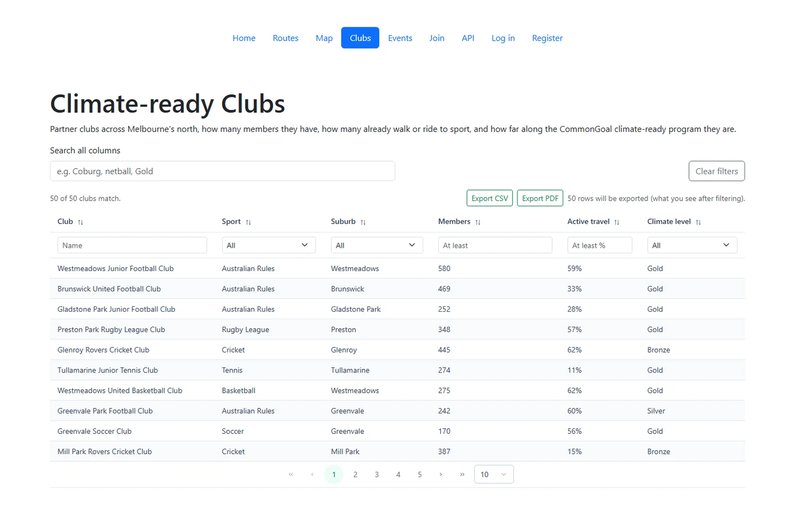
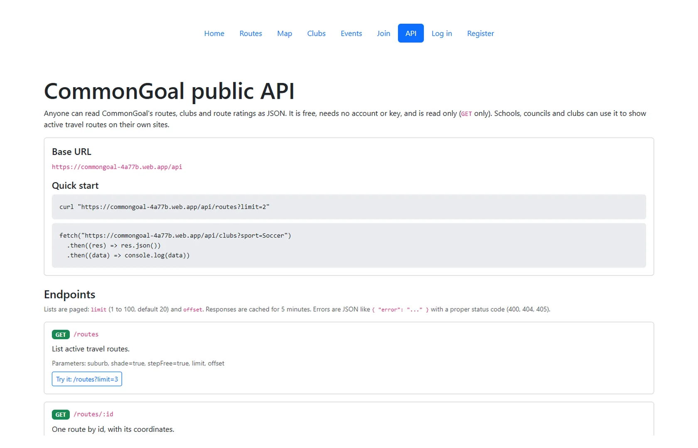

# CommonGoal

A web app for a Melbourne not-for-profit that helps community sports clubs go climate-ready and makes walking, riding and scooting the default way families get to training, games and school.

**Live:** https://commongoal-4a77b.web.app



Built solo for Monash University (FIT5032, Internet Applications Development), August to October 2026, in three stages: a Vue front end, then accounts and roles on Firebase, then cloud functions, maps, email, charts and an API. The organisation is a fictional brief; the clubs and events are generated test data.

## Features

**For everyone**
- Home page with audience cards and impact stats, responsive from 375 px up
- Active travel routes with live search, a shade filter, and member ratings (1 to 5, average shown live)
- Route map (Mapbox GL): a pin per route, place search, walking or riding directions with distance, time and turn by turn steps, "use my location"
- Clubs (50 rows) and events (40 rows) tables: sort on every column, global search, a filter per column, paging, and CSV or PDF export of exactly the rows on screen
- Public read-only REST API with a docs page and "Try it" examples

**Signed in**
- Email and password or Google sign-in
- Member dashboard, rate routes, share a route by email with an attachment (PDF, PNG, JPG, TXT or CSV, up to 2 MB)

**Admin**
- Overview: users, members and admins, new this week, ratings, average, emails sent, most rated route
- Chart.js charts from live Firestore data (average rating per route with a click-through breakdown, users by role, ratings per day)
- User table with role changes and bulk email (each person gets their own copy, `{{name}}` merge)

| | |
|---|---|
|  |  |
| Admin console with live charts | Clubs table with filters and export |



## Stack

| Part | Tech |
|---|---|
| Front end | Vue 3 (Composition API), Vue Router, PrimeVue 5, Bootstrap 5, Vite |
| Data and auth | Firebase Auth (email and Google), Firestore with security rules |
| Server | Cloud Functions for Firebase (2nd gen, `australia-southeast2`), Express for the public API |
| Integrations | Mapbox GL JS, Geocoding and Directions APIs; Brevo transactional email |
| Charts and export | Chart.js, jsPDF with AutoTable, CSV |
| Hosting | Firebase Hosting (SPA rewrite, security headers, long cache for hashed assets) |

## How it fits together

The Vue app talks to Firestore directly for reads and simple writes; the Firestore rules are the real access control. Anything that needs a secret or must not be faked runs in a Cloud Function:

| Function | Trigger | Who can call it |
|---|---|---|
| `onRatingWritten` | Firestore write on `ratings/{id}` | Firestore only; keeps per-route rating stats correct |
| `rebuildRouteStats` | HTTP POST | admin |
| `setUserRole` | HTTP POST | admin (cannot change their own role), writes an audit log |
| `sendEmail` | HTTP POST | any signed-in user |
| `sendBulkEmail` | HTTP POST | admin |
| `api` | HTTP GET | anyone; public data only |

Every protected function checks `Authorization: Bearer <Firebase ID token>` with the Admin SDK, then reads the caller's role from Firestore. A missing or bad token gets 401, a non-admin gets 403.

Public API endpoints: `/api/routes`, `/api/routes/:id`, `/api/routes/:id/stats`, `/api/clubs`, `/api/clubs/:id`. Paging, filters, JSON errors (400, 404, 405), CORS and caching.

## Security

- **Roles:** everyone who registers is a `member`. Roles change only through `setUserRole`; the Firestore rules block any client from writing a role, including to their own profile.
- **Guarded twice:** the router guard is for user experience; the Firestore rules enforce access on the server even if the client code is edited.
- **Ratings cannot be faked:** one rating per member per route (`ratings/{uid}_{routeId}`), score 1 to 5, and the averages are written only by `onRatingWritten`.
- **Secrets:** the Brevo key lives in Google Secret Manager and only the two email functions can read it. The Firebase web config is public by design; the rules are what protect the data.
- **Input:** every function validates its input again on the server. User text is stripped of `<` and `>` before it is stored and there is no `v-html` in the app (tested with `` as a name). Length caps match the rules.
- **Abuse limits:** 5 single emails and 3 bulk sends per user per 10 minutes.
- **Auth errors:** one generic message for every login failure, so the app never confirms which emails have accounts.
- **Exports:** CSV cells starting with `=`, `+`, `-` or `@` are neutralised against formula injection.

## Accessibility

Aimed at WCAG 2.1 AA: skip link, page titles and focus moved on navigation, labelled inputs with `aria-invalid` and `aria-describedby`, errors announced with `role="alert"`, `autocomplete` on forms, labelled rating buttons, a visible focus ring, reduced motion respected, and text alternatives for the map and charts. Lighthouse accessibility scored 100 on every page tested.

## Try it

Register a member account on the live site, or use **Continue with Google**. The admin account is not shared publicly; the screenshots above show the admin console.

## Run locally

Needs Node.js 22.18 or later and your own Firebase project.

```sh
npm install
cp .env.example .env.local   # fill in your Firebase web config and a Mapbox public token
npm run dev
```

| Variable | What it is |
|---|---|
| `VITE_FIREBASE_*` | Firebase web config |
| `VITE_MAPBOX_TOKEN` | Mapbox public token (`pk.`), restricted to your site URLs |
| `VITE_PRIMEUI_LICENSE` | PrimeUI Community licence key (free) |
| `VITE_FUNCTIONS_BASE_URL` | Base URL of your Cloud Functions |

Cloud Functions (Firebase CLI, Blaze plan):

```sh
cd functions && npm install && cd ..
firebase functions:secrets:set BREVO_API_KEY
firebase deploy --only functions,firestore:rules
```

Deploy the site:

```sh
npm run build
firebase deploy --only hosting
```

## Project structure

```
src/views/        one file per page (Home, Routes, Map, Clubs, Events, Share, Admin, Api docs, auth pages)
src/components/   header, rating, export buttons, admin overview, charts, bulk email dialog
src/stores/       auth and ratings state (Firebase listeners)
src/utils/        security helpers, Mapbox, export
functions/        Cloud Functions (index.js) and the public API (api.js)
firestore.rules   server-side access rules
```

## Credits

- Class patterns from FIT5032 studios (form validation, PrimeVue DataTable, Vue Router guards, Firebase auth with an `authReady` promise).
- Docs used: [Firebase](https://firebase.google.com/docs), [Firestore rules](https://firebase.google.com/docs/firestore/security/get-started), [PrimeVue](https://primevue.org/), [Mapbox GL JS](https://docs.mapbox.com/mapbox-gl-js/), [Brevo API](https://developers.brevo.com/reference/sendtransacemail), [Chart.js](https://www.chartjs.org/docs/), [jsPDF](https://github.com/parallax/jsPDF), [WCAG 2.1 quick reference](https://www.w3.org/WAI/WCAG21/quickref/).

Built by Laurensius Joshua Anrico Agustinus. Portfolio: https://joshuaanrico.github.io
